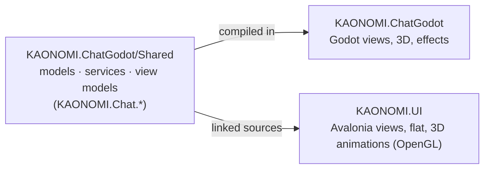

# KAONOMI.UI

The Kaonomi chat in **Avalonia UI 12**: a clone of [`KAONOMI.ChatGodot`](../KAONOMI.ChatGodot/README.md), flat (no
3D cards, no tweens, no glow) but **with its 3D animations** (the faces and JARVIS of the chat and of the voice mode)
and **its themes with their animated backgrounds**, drawn with OpenGL from the same shaders. Every command works the same: both chats run the same
view models and services.

```bash
dotnet run --project KAONOMI.UI
dotnet run --project KAONOMI.UI -- --command=/alarm;/iq     # opens tools at the start
dotnet run --project KAONOMI.UI -- --prompt="Bonjour"       # sends a first prompt once the server and the models answer
dotnet run --project KAONOMI.UI -- --avatar=HAL --voice     # the preset of that 3D animation, in the voice mode
dotnet run --project KAONOMI.UI -- --theme=Matrix --themes  # starts in that theme (not kept), with the screen of the themes
```

It needs the same back end as the Godot chat (the Server, Ollama, and optionally the gateway), and reads the same
`config.yml` / `config.json` (linked from `KAONOMI.ChatGodot`).

## How it is built



- **`Shared/` is not copied**: `KAONOMI.UI.csproj` compiles `..\KAONOMI.ChatGodot\Shared\**\*.cs` as linked files (and
  `Scripts/Shims/ChatViewShims.cs`). A change of a view model or a service is a change for both chats.
- **The views are written in C#** (no AXAML), like the Godot ones, with the helpers of `Desk/Ui.cs` (controls in the
  colours of the EVE theme, bindings to the view models).
- **The same view contract**: a view is a class with `[ToolView(typeof(SomeViewModel), title, icon, width, height)]`
  implementing `IToolView.Build(viewModel, shell)`; it is found by reflection (`Desk/Shell.cs`).
- **A view model without a view of its own still opens**: `Desk/AutoView.cs` builds a window from what it offers (its
  commands as buttons, its properties as fields, its collections as lists with the fields of the item selected).

## The window

| Part | File | What it does |
|---|---|---|
| Bar of commands | `Desk/Neocom.cs` | The K (double-click: full screen), `›_` (type a command or a prompt), one icon per tool (a line on its left while its window is open), `/config` at the bottom |
| Desktop | `Desk/DeskArea.cs` | The tool windows: move them by their header, resize them by their corner, ❐ clone, minimise, maximise (double-click on the header), close (asks first when the view model has changes not saved); a **task bar** at the bottom in place of the 3D cards; Ctrl+Tab goes to the next window. The windows open at the close come back at the next start (`~/kaonomi/ui-windows.txt`) |
| Chat | `Chat/ChatPanel.cs` | The clock (double-click: `/alarm`) with the next alarm, the state of the server, the 3D animation of the preset with the state of the assistant over it (listening, processing, speaking; double-click: the voice mode), the ticker (still text), the model, preset and history, the system prompt, the conversation (Markdown answers via Markdig, 👍 👎, copy, code, stats), the input (Enter: send, ↑ ↓: previous prompts), the push-to-talk 🎤 with its language, STOP / SEND, the exports (JSON, Word) and the saved prompts |
| 3D animations | `Avatar/Avatar3D.cs`, `Avatar/Gl.cs` | The faces (MARI, KAONOMI, JEROME, HAL, MARIEKILLEUSE, MUSUKO, KAONAMI, PEPPER, GREEN, JEROMELIVE, MARVIN, CIRCUIT, MOTUKO, LIN) and JARVIS, with the GLSL of `Shared/Views/SceneShaders.cs` compiled as it is (GLSL ES 3 on ANGLE, 3.3 on desktop OpenGL) in an `OpenGlControlBase`: a face is its image on a grid of 193 × 193 points in relief seen by a 3D camera, the head sways, the jaw drops with the voice while the answer is read aloud and with the words shown otherwise, a band glitches now and then; JARVIS is one ray per pixel (rings, sphere, core, spectrum) driven by the same level. The images are those of the Godot chat (`Assets/*-face.png`) |
| Voice mode | `Chat/VoiceMode.cs` | The animation alone over the window (a double-click on it, `/fullchat`, `--voice`, FULLSCREEN:ON of `/remote`), its state, a box to type a prompt or a command (Enter: send, ↑ ↓: previous prompts; a command opening a window leaves the voice mode), the push-to-talk 🎤 (or the space bar), STOP, LEAVE (Escape) |
| Themes | `Themes/` | The 9 themes of the Godot chat (🎨 at the bottom of the bar, `/theme:matrix`, `/getthemes`): EVE, Kaonomi, Matrix, Ghost, Analyst, Minimal, Defense, Police, Trading, with their colours (translucent panels), their fonts and their animated background: the `.gdshader` of the Godot chat, read as it is from `Shaders/` and translated to GLSL at the start (`GodotShader.cs`: the uniforms become constants, the built-ins of Godot become globals), drawn behind the whole window over the picture of the theme (Ghost), brighter while the answer is read aloud. A theme applies at once (the shared brushes are recoloured in place: nothing is built again, nothing typed is lost) and is kept in `~/kaonomi/ui-theme.txt` |
| Alarms | `Tools/Alarms/` | The alarms of `/alarm` and the reminders of `/calendar` ring even with their windows closed: the window goes full screen in the voice mode, the ringtone (Bell, Digital, Chime, Rising, made by the code) grows from soft to loud, the voice says "Bouge ton cul, gros !" in the language of the chat; STOP / SNOOZE (Enter, Escape, Space / S) |
| Dialogs | `Desk/Dialogs.cs` | The file pickers of the system and small modal dialogs (message, confirmation, text), with the same calls as in the Godot chat |

## The tools

Every tool of the Godot chat has its view (51 views, the same titles, icons and sizes), one folder per family:

| Folder | Tools |
|---|---|
| `Tools/Daily` | `/alarm`, `/calendar`, `/iq`, `/game:chess`, `/game:go`, `/game:solitaire` |
| `Tools/Data` | `/activity`, `/folders`, `/cache`, `/search`, `/json`, `/cmd`, `/symbol`, `/config`, `/preset`, `/process`, `/gateway`, `/system`, `/log`, `/token`, the code windows, notes, annotations, evaluations; the right-click menu of every text (annotate, translate, analyse) and the journal of the SAVEs |
| `Tools/Writing` | `/write` (ghost writer), `/journal`, `/wiki`, `/interview` (the person interviewed, the notes, the recordings as WAV in `~/kaonomi/audio/interview`, their transcription by Whisper, live or when the recording stops, a paragraph per silence of a second, each stored in the search engine), `/idea`, `/intel`, `/project` (kanban), `/collectionplan`, `/completion` (charts, word cloud). The journal, the wiki, the interviews and the chapters of `/write` are edited as they read, with the editor and the ribbon of `/work` (`TapePage.cs`), as in the Godot chat; their text stays Markdown |
| `Tools/Knowledge` | `/ontology`, the entity windows, `/relation` (the 2D graph, the 3D graph as in the Godot chat: a shape per entity type, the time in depth, the probability in height, the arrows of the periods, the blobs of the clusters, the FPS mode; drawn with OpenGL, the names by Avalonia; the timeline, the clusters), `/bpmnai`, `/infra`, `/mindmap` |
| `Tools/Work` | `/work`: the tape (a rich editor drawn by the code: formatting, pictures with crop, code blocks), its ribbon, the calculator, the graph of functions, the exports Word / PDF / JSON |
| `Tools/Media` | `/music`, `/remote`, `/youtube` (played in the browser, as in the Godot chat), `/pictures`, `/fooocus`, the image analysis, `/immune`, `/fractal` (computed on the CPU, in parallel) |

`dotnet build -p:OnlyTools=Data` compiles one folder of views alone (with the ringer of the alarms; `Writing` brings `Work`, whose editor it uses).

## What is left out

| Godot chat | KAONOMI.UI |
|---|---|
| The voice mode: the windows shelved in a row at the bottom, the kiosk lock | The animation alone over the window, no lock |
| `/think`, the intro | Not there |
| The windows sent to the back as 3D cards | A task bar |
| `/setup`, `/audiosettings` | Run them in the Godot chat: their choices (`config.yml`, the audio devices) are shared |
| The immune scan, the music meter, the graph settling: animated | Drawn still, redrawn at each change |
| "Set as wallpaper" | Not there |
